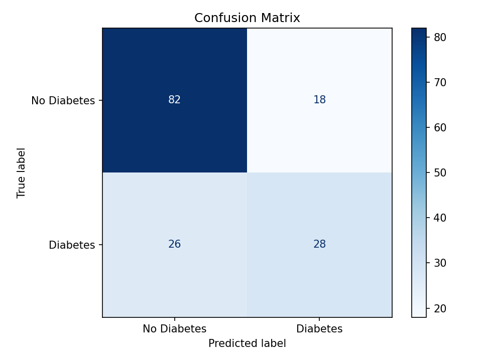
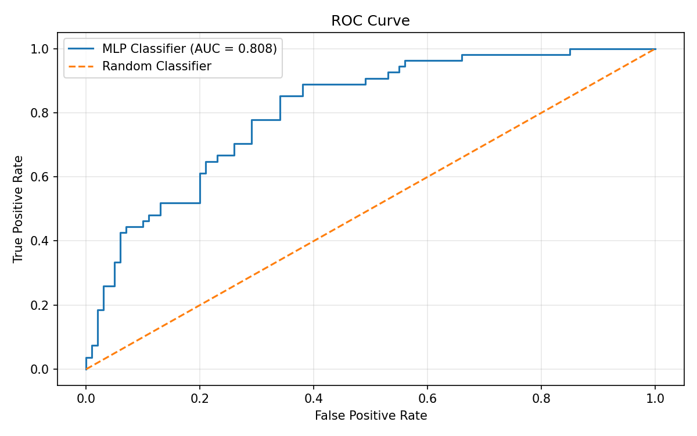
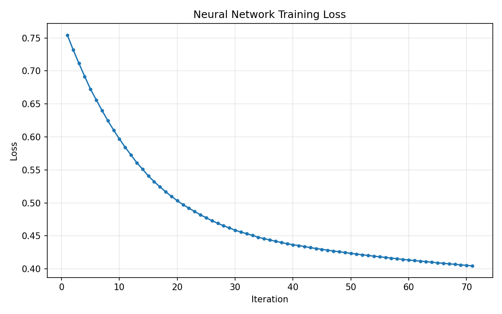

# 🩺 DiaRisk — Diabetes Risk Classification with a Neural Network


DiaRisk is an end-to-end machine learning pipeline that predicts whether a patient is likely to have diabetes from eight routine clinical measurements. It uses a small feed-forward neural network (a multilayer perceptron) built with scikit-learn, wrapped in a single `Pipeline` so that preprocessing and the model are trained, evaluated, and saved together.


---

## 📊 Results

Evaluated on a held-out, stratified test set of 154 patients (20% of the data).

| Metric | Value |
|---|---|
| Accuracy | **71.43%** |
| ROC-AUC | **0.8076** |
| Macro F1 | 0.6742 |
| Diabetes recall (sensitivity) | 0.5185 |
| Diabetes precision | 0.6087 |
| No-diabetes recall (specificity) | 0.8200 |

**Classification report**

| Class | Precision | Recall | F1 | Support |
|---|---|---|---|---|
| No Diabetes | 0.7593 | 0.8200 | 0.7885 | 100 |
| Diabetes | 0.6087 | 0.5185 | 0.5600 | 54 |
| Weighted avg | 0.7065 | 0.7143 | 0.7084 | 154 |

**Confusion matrix** (rows = actual, columns = predicted)

| | Pred: No Diabetes | Pred: Diabetes |
|---|---|---|
| **Actual: No Diabetes** | 82 | 18 |
| **Actual: Diabetes** | 26 | 28 |

<p align="center">
  
  
</p>
<p align="center">
  
</p>

### How to read these numbers

- The test set is 65% "No Diabetes", so always predicting the majority class would score ≈ 65% accuracy. The model beats that baseline, but by a modest margin.
- The ROC-AUC of 0.81 shows the model **ranks** patients reasonably well. The default 0.5 decision threshold, however, misses about half of the true diabetes cases (26 of 54). For a screening use case, lowering the threshold to trade precision for recall would be the first thing to try.
- With only 154 test samples, the 95% confidence interval on accuracy is roughly ±7 percentage points.

---

## 🗂️ Dataset

- **File:** `diabetes.csv` — 768 rows, 8 numeric features, 1 binary target (the Pima Indians Diabetes Database)
- **Features:** `Pregnancies`, `Glucose`, `BloodPressure`, `SkinThickness`, `Insulin`, `BMI`, `DiabetesPedigreeFunction`, `Age`
- **Target:** `Outcome` (0 = no diabetes, 1 = diabetes)
- **Class balance:** 500 negative / 268 positive

In this dataset, a value of `0` in `Glucose`, `BloodPressure`, `SkinThickness`, `Insulin`, or `BMI` is physiologically impossible and actually encodes a **missing measurement**. DiaRisk converts those zeros to `NaN` and imputes them (zero `Pregnancies` is valid and left untouched).

---

## ⚙️ Approach

```
diabetes.csv
   │
   ├─ replace 0 → NaN in Glucose, BloodPressure, SkinThickness, Insulin, BMI
   ├─ stratified 80/20 train/test split (random_state=42)
   ▼
Pipeline
   ├─ SimpleImputer(strategy="median")
   ├─ StandardScaler()
   └─ MLPClassifier(hidden_layer_sizes=(32, 16), activation="relu",
                    solver="adam", learning_rate_init=0.001, max_iter=1000,
                    early_stopping=True, validation_fraction=0.15,
                    n_iter_no_change=30, random_state=42)
```

- Imputation and scaling are fit **only on the training data** inside the pipeline, which prevents test-set leakage.
- Early stopping holds out 15% of the training data as a validation set and halted training after 71 iterations (final training loss 0.4046).
- The network has 833 trainable parameters (8 → 32 → 16 → 1).

---

## 🚀 Getting started

```bash
git clone https://github.com/bodymostafa1/DiaRisk.git
cd DiaRisk
python -m venv .venv
source .venv/bin/activate        # Windows: .venv\Scripts\activate
pip install -r requirements.txt
python diarisk.py
```

`requirements.txt`

```
numpy
pandas
matplotlib
scikit-learn
joblib
```

Place `diabetes.csv` in the project root (or in `data/` and update `data_path`). Running the script prints the dataset summary and metrics, displays the three charts, and saves the trained pipeline to `diabetes_mlp_classifier.pkl`.

---

## 🔮 Using the saved model

The saved pipeline imputes and scales for you, but the **zero → NaN conversion happens outside the pipeline**, so apply it yourself before predicting:

```python
import joblib
import numpy as np
import pandas as pd

model = joblib.load("diabetes_mlp_classifier.pkl")

patient = pd.DataFrame([{
    "Pregnancies": 2, "Glucose": 120, "BloodPressure": 70,
    "SkinThickness": 20, "Insulin": 80, "BMI": 28.5,
    "DiabetesPedigreeFunction": 0.35, "Age": 33,
}])

# Same treatment as training: zeros in these columns mean "not measured"
missing_as_zero = ["Glucose", "BloodPressure", "SkinThickness", "Insulin", "BMI"]
patient[missing_as_zero] = patient[missing_as_zero].replace(0, np.nan)

probability = model.predict_proba(patient)[0, 1]
print(f"Estimated diabetes probability: {probability:.2%}")
```

> The `.pkl` file is tied to the scikit-learn version used to create it, and pickle files should only be loaded from sources you trust. Re-run `diarisk.py` to regenerate it for your own environment.


---

## ⚠️ Limitations

- Small dataset (768 rows) and a single train/test split — results will vary with a different split or seed.
- The dataset covers a specific population (adult women of Pima Indian heritage), so performance may not transfer to other groups.
- Sensitivity for the diabetes class is low at the default threshold (51.9%).
- No hyperparameter search, cross-validation, or comparison against other models yet.

## 🛣️ Roadmap

- [ ] k-fold cross-validation with confidence intervals
- [ ] Baselines: logistic regression, random forest, gradient boosting
- [ ] Decision-threshold tuning for higher recall
- [ ] Hyperparameter search (layer sizes, regularization, learning rate)
- [ ] Probability calibration and feature-importance analysis
- [ ] Move the zero → NaN step inside the pipeline for safer deployment
- [ ] Simple web demo (Streamlit / FastAPI)

---

## 👤 Author

**Abdelrahman Mostafa Kamal** — Data Science & AI, Cairo University

## 📄 License

Add a license of your choice (e.g., MIT) as `LICENSE`. Check the original dataset's terms before redistributing `diabetes.csv`.
